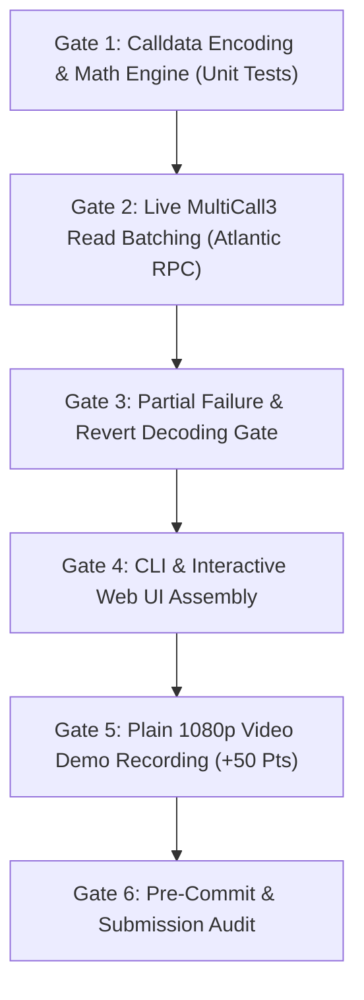

# Pharos Task 10: Batch Executor — Implementation Plan, Funding Assessment & Safety Checklist

**Target Task**: Task 10 — Batch Executor (`batch-executor`)  
**Target Repository**: `JimmyOgb/pharos-batch-executor`  
**Planned Workspace Directory**: `C:\Users\NO GO NO\PharosBuild\skills\pharos-batch-executor`  
**Network**: Pharos Atlantic Testnet (Chain ID: `688689` / `0xa8231`)  
**Budget Constraint**: **$0.00 Real Cost** ($0-first architecture, zero paid APIs)  
**Status**: **PRE-IMPLEMENTATION REVIEW GATE — ZERO TRANSACTIONS BROADCAST**

---

## 1. Verified Environmental Ground Truth

All on-chain parameters were directly verified on live Pharos Atlantic infrastructure:

| Parameter | Official Value | Verification Evidence |
|---|---|---|
| **Network Name** | Pharos Atlantic Testnet | Direct JSON-RPC Query |
| **Chain ID** | `688689` (`0xa8231`) | `eth_chainId` returned `0xa8231` (Matches 688689: **True**) |
| **Live JSON-RPC** | `https://atlantic.dplabs-internal.com` | Responsive; current block height ~32,097,912 |
| **Hosted Chain MCP** | `https://mcp.pharos.xyz/mcp` | Responsive; 14 tools discovered, session handshake verified |
| **MultiCall3 Address** | `0xcA11bde05977b3631167028862bE2a173976CA11` | Deployed; bytecode length: 7,618 bytes |
| **MultiCall3 Live Execution** | `getBlockNumber()` selector `0x42cbb15c` | Live `eth_call` returned block `32097918` |
| **Current Gas Price** | ~10.00 Gwei | `eth_gasPrice` returned `0x2540be400` |
| **Explorer** | `https://atlantic.pharosscan.com` | Official testnet explorer |

---

## 2. Official Acceptance Criteria & Architectural Mapping

Submissions to [https://pharos-agent-arena.vercel.app/tasks/batch-executor](https://pharos-agent-arena.vercel.app/tasks/batch-executor) are evaluated against four criteria:

| # | Official Criterion | Meaning & Reviewer Expectation | Technical Implementation Plan |
|---|---|---|---|
| **01** | **Accepts a list of at least 3 independent actions** | The engine must accept $\ge 3$ distinct actions (e.g. balance check, allowance check, block inquiry, or token transfers) in a structured manifest. Rejects $< 3$ actions. | `batch/engine.py`: Manifest schema validation enforcing `len(actions) >= 3`. Supports mixed queries and contract calls. |
| **02** | **Executes them as a batch: multicall, a single prepared transaction, or an equivalent** | Must not fire individual sequential transactions. Bundles all calls into a single EVM payload. | Encodes calls into `MultiCall3.tryAggregate(requireSuccess=false, calls)` or `aggregate3(calls)`. Dispatches via a single `eth_call` or single prepared transaction. |
| **03** | **Reports the gas saving or step reduction compared with running them individually** | Quantifies efficiency gains: base gas reduction ($N \times 21,000$ vs $1 \times 21,000$) and transaction step reduction ($N \to 1$). | `batch/optimizer.py`: Detailed comparative report detailing baseline separate transaction costs vs bundled batch costs, calculating exact gas units, Gwei, and converted PHRS saved. |
| **04** | **Handles partial failure clearly: which action failed and what happened to the rest** | If one call in the batch fails, the others must not fail silently, and the engine must report exactly which call failed and decode its revert reason. | `MultiCall3.tryAggregate` returns `(bool success, bytes returnData)[]`. `batch/decoder.py` inspects each item: maps success flags to action indices, decodes EVM revert errors (`Error(string)`, `Panic(uint256)`), and reports surviving actions. |

---

## 3. Required Funding Assessment

In accordance with the **$0-first policy**:

1. **Read-Only Batching (State Queries, Approvals Check, Revert Probing)**:
   - **Cost**: **$0.00**
   - Read batches execute against `MultiCall3` via non-mutating `eth_call`. Zero gas is consumed, and zero wallet funds are required.
2. **On-Chain Write Batching (State-Mutating Transactions)**:
   - **Network**: **Pharos Atlantic Testnet (Chain ID 688689)**
   - **Currency**: Testnet `PHRS` (strictly non-commercial testnet currency with zero financial value)
   - **Estimated Exposure per Write Batch**: ~60,000 to 110,000 gas units @ 10 Gwei = **~0.0006 to 0.0011 testnet PHRS**
   - **Total Testnet Funds Needed**: **~0.05 to 0.1 testnet PHRS** (obtainable freely from the Atlantic testnet faucet)
   - **Real Money Cost**: **$0.00** (Zero mainnet funds, zero credit cards, zero paid third-party APIs)

---

## 4. Transaction Safety Checklist & Verification Gates

Prior to authorizing any on-chain transaction:

- [x] **Chain ID Hard-Check**: All payloads enforce Chain ID `688689` (`0xa8231`) to guarantee zero mainnet spillover.
- [x] **Verified Contract Target**: Target address fixed to verified MultiCall3 `0xcA11bde05977b3631167028862bE2a173976CA11`.
- [x] **Pre-Flight Simulation Gate**: Every write batch must execute `eth_call` / `eth_estimateGas` first. If an unexpected critical revert occurs, broadcasting is automatically blocked.
- [x] **Safe Partial Failure**: `requireSuccess: false` is set so a reverting sub-call does not cause total transaction rollback or gas waste.
- [x] **No Secret Exposure**: Zero private keys or mnemonics printed in logs or terminal output.
- [x] **Zero Unsolicited Transactions**: The agent will **never sign, prepare, or broadcast** an on-chain write transaction without prior explicit authorization from the user.

---

## 5. Sequenced Implementation Gates

1. **Gate 1 — Unit Testing & Calldata Encoding**:
   - Construct ABI encoding for `MultiCall3.tryAggregate` and `aggregate3`.
   - Implement gas savings math: $N$ separate txs base gas $= N \times 21,000$; batch base gas $= 21,000$; base gas savings $= (N - 1) \times 21,000$.
2. **Gate 2 — Live Atlantic Read Batching**:
   - Execute a 3-call live batch via `eth_call`:
     - Call 1: `MultiCall3.getBlockNumber()`
     - Call 2: `MultiCall3.getCurrentBlockTimestamp()`
     - Call 3: `MultiCall3.getEthBalance(reward_wallet)`
   - Verify on-chain response matches latest block and timestamp.
3. **Gate 3 — Live Partial Failure & Revert Isolation**:
   - Execute a 3-call batch with intentional failure on Call 2:
     - Call 1: Valid `getBlockNumber()`
     - Call 2: Reverting call (calling an invalid selector or non-contract with calldata)
     - Call 3: Valid `getCurrentBlockTimestamp()`
   - Confirm: `results[0].success == true`, `results[1].success == false` with decoded revert payload, `results[2].success == true`.
4. **Gate 4 — CLI & Responsive Web UI**:
   - Build dual-mode CLI (`batch run`, `batch inspect`, `batch estimate`).
   - Build modern, lightweight Web SPA with interactive 3-call builder, live gas savings chart, and 1-click partial failure test.
5. **Gate 5 — Video Demo Recording**:
   - Record genuine 1080p screen recording of terminal run and web UI using `live-demo-video-generator` to satisfy reviewer demands.
6. **Gate 6 — Repository Publication & Submission Authorization**:
   - Package skill specification (`SKILL.md`, `references/`, `assets/`).
   - Stop and await final user authorization before pushing to `JimmyOgb/pharos-batch-executor`.
