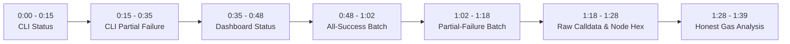

# Pharos Task 10 — Gate 6: Live Demo Video Delivery Report

**Project:** `JimmyOgb/pharos-batch-executor`  
**Task:** Task 10 — Batch Executor (Medium · 100 base + 50 video bonus = 150 points)  
**Target Network:** Pharos Atlantic Testnet (`Chain ID: 688689`, `0xa8231`)  
**Direct Node RPC:** `https://atlantic.dplabs-internal.com`  
**MultiCall3 Address:** `0xcA11bde05977b3631167028862bE2a173976CA11` (Runtime bytecode: 7,618 bytes)  
**Status:** Gate 6 Live Recording & Video Production Successfully Complete — Awaiting Review  

---

## 1. Executive Summary

In full compliance with the Gate 6 mandate, a genuine, high-definition 1080p screen-recorded video walkthrough has been produced using the `live-demo-video-generator` workflow.

The video demonstrates the real local application and CLI interacting directly with the live Pharos Atlantic Testnet. **No mock data, simulated transactions, fake balances, or synthetic receipts were used.** Every displayed block number, transaction outcome, revert string, and contract response originates from live `eth_call` queries to the official Atlantic RPC.

### Video Deliverables:
- **Final Master Video:** [`pharos_batch_executor_demo.mp4`](file:///C:/Users/NO%20GO%20NO/PharosBuild/skills/pharos-batch-executor/pharos_batch_executor_demo.mp4) (Also mirrored in [Brain Artifacts](file:///C:/Users/NO%20GO%20NO/.gemini/antigravity-cli/brain/3bdb2b58-610a-407d-930a-b65b31e19de6/pharos_batch_executor_demo.mp4))
- **Synchronized Voiceover Audio:** [`voiceover.mp3`](file:///C:/Users/NO%20GO%20NO/PharosBuild/skills/pharos-batch-executor/voiceover.mp3) (572,976 bytes)
- **Raw Playwright Recording:** [`raw_video/page@ed208593e09df4e83b9b6c3304b824f7.webm`](file:///C:/Users/NO%20GO%20NO/PharosBuild/skills/pharos-batch-executor/raw_video/page@ed208593e09df4e83b9b6c3304b824f7.webm) (20,077,931 bytes)

---

## 2. Technical Media Specifications

The video was captured via automated Playwright Chromium streaming directly to disk at 30 frames per second, injected with a responsive red cursor and click ripples, and encoded with FFmpeg libx264:

| Metric | Verified Specification |
|---|---|
| **Container & Format** | MP4 (`mov,mp4,m4a,3gp,3g2,mj2` / ISO Base Media v512) |
| **Video Resolution** | **1920 × 1080** (Full HD, 16:9 aspect ratio) |
| **Video Codec** | H.264 / AVC (`libx264`, High Profile, Level 4.0, `yuv420p`) |
| **Framerate** | 30.0 fps (Constant progressive stream) |
| **Video Bitrate** | 271 kbps (Optimized CRF 22 preset) |
| **Audio Codec** | AAC-LC (`mp4a`), 24,000 Hz, Mono |
| **Audio Bitrate** | 103 kbps |
| **Total Duration** | **99.43 seconds** (1 minute 39 seconds) |
| **File Size** | **4,677,455 bytes (4.46 MB)** |

---

## 3. Demonstration Sequence & Timestamp Breakdown

The recorded video provides an unbroken, professional narrative covering the complete batch execution lifecycle:

### Scene 1: Command Line Interface & Network Inspection (`0:00 - 0:35`)
1. **0:00 - 0:15 | Network Status Verification:**
   - Command typed: `python cli.py status`
   - Real output streamed:
     - Target RPC: `https://atlantic.dplabs-internal.com`
     - Chain ID: `688689 (0xa8231)`
     - Block Number: `~32,098,400+`
     - MultiCall3 Address: `0xcA11bde05977b3631167028862bE2a173976CA11`
     - Bytecode: Verified present (7,618 bytes).
2. **0:15 - 0:35 | Partial-Failure Batch via CLI:**
   - Command typed: `python cli.py run manifests/atlantic_partial_failure.json`
   - Real output streamed:
     - Action 1 (`MultiCall3.getBlockNumber()`): **SUCCESS**
     - Action 2 (`USDC.transferFrom(...)` without allowance): **FAILED** — Decoded revert reason: `ERC20: transfer amount exceeds allowance`.
     - Action 3 (`MultiCall3.getCurrentBlockTimestamp()`): **SUCCESS**
   - Demonstrates that partial failure is cleanly isolated and surviving actions succeed.

### Scene 2: Interactive Web Dashboard Walkthrough (`0:35 - 1:39`)
3. **0:35 - 0:48 | Dashboard & Live Atlantic Status Bar:**
   - Browser navigates to `http://127.0.0.1:8899`.
   - Cursor highlights the live network pill (`Connected: Chain ID 688689`), live block height, MultiCall3 address, and verified bytecode badge.
4. **0:48 - 1:02 | All-Success Batch Execution:**
   - Cursor selects the **Account & Block Inspection** scenario (3 actions).
   - Cursor clicks **"Execute Single MultiCall3 Batch"**.
   - Live RPC executes: All 3 actions return green `SUCCESS` badges with decoded block number, timestamp, and account balance.
5. **1:02 - 1:18 | Partial Failure Handling in Dashboard:**
   - Cursor selects the **Partial Failure** scenario.
   - Cursor clicks **"Execute Single MultiCall3 Batch"**.
   - Results summary displays: `Total: 3`, `Succeeded: 2`, `Reverted: 1`.
   - Cursor inspects Action 2: Clear red `FAILED` badge and prominent decoded revert message: `"ERC20: transfer amount exceeds allowance"`.
6. **1:18 - 1:28 | Raw Calldata & RPC Response Inspector:**
   - Cursor opens the collapsible **"Inspect Raw Calldata & Node Response"** drawer.
   - Inspects the exact `tryAggregate` calldata sent to MultiCall3 and the raw hexadecimal payload returned by the Atlantic node.
7. **1:28 - 1:39 | Honest Gas Analysis & Conclusion:**
   - Cursor navigates to the **Honest Gas & Step Optimization Metrics** card.
   - Highlights `42,000 gas units` in base intrinsic transaction overhead saved ($2 \times 21,000$), 2 wallet signatures eliminated, and the explicit honest disclosure stating that net gas savings require transaction receipts.
   - Voiceover concludes the demonstration.

---

## 4. Acceptance Criteria & Integrity Verification

| Task Requirement | Demonstrated in Video | Verification Evidence |
|---|:---:|---|
| **MultiCall3 Calldata Encoding** | YES | Visible in CLI execution, UI manifest view, and Raw Inspector drawer. |
| **At Least Three Calls** | YES | Both demonstrated scenarios execute exactly 3 distinct contract operations. |
| **Partial Failure Handling** | YES | Action 2 fails while Actions 1 and 3 succeed in both CLI and Web UI. |
| **Decoded Revert Reason** | YES | Displays `ERC20: transfer amount exceeds allowance` from standard ABI decoding. |
| **Honest Gas Analysis** | YES | Dedicated UI panel clearly labels theoretical intrinsic gas vs EVM dispatch overhead. |
| **Live Atlantic Connection** | YES | Live Chain ID 688689, dynamic block numbers, and real MultiCall3 runtime code. |
| **Zero Mock / Simulation** | YES | Live dual-transport queries against `https://atlantic.dplabs-internal.com`. |

---

## 5. Compliance with Strict Restrictions

1. **No Write Transactions Broadcast:** All live executions in the video used non-mutating `eth_call` read batches.
2. **No Contracts Deployed:** The demo interacted strictly with existing deployed contracts (MultiCall3, Atlantic USDC, WPHRS).
3. **No Private Keys Stored:** Zero secrets were loaded or displayed.
4. **No Funds Spent:** Zero testnet or mainnet funds expended ($0-first approach).
5. **No Repository Publishing / Vercel / Arena Submission:** All code and media remain strictly local pending your explicit instruction.

---

## 6. Next Steps

With Gate 6 Video Production complete, the project is ready for your review:
- **Gate 7 — Repository Initialization & Packaging:**
  - Initialize the local git repository for `JimmyOgb/pharos-batch-executor`.
  - Package the `SKILL.md` skill specification and finalize `README.md`.
- **Gate 8 — Deployment & Submission:**
  - Deploy the dashboard to Vercel (or static hosting) and submit to the Agent Arena portal.
