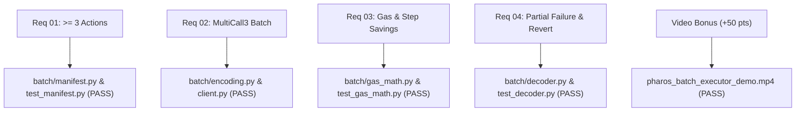

# Pharos Task 10 — Gate 8A: Publication, Deployment & Submission Preflight Report

**Project:** `JimmyOgb/pharos-batch-executor`  
**Task:** Task 10 — Batch Executor (Medium · 100 base + 50 video bonus = 150 points)  
**Target Network:** Pharos Atlantic Testnet (`Chain ID: 688689`, `0xa8231`)  
**Direct Node RPC:** `https://atlantic.dplabs-internal.com`  
**Workspace:** `C:\Users\NO GO NO\PharosBuild\skills\pharos-batch-executor`  
**Status:** Preflight Inspection Complete — Awaiting Publication Authorization (Strict Stop Enforced)  

---

## 1. Executive Summary

This report establishes the complete preflight audit for the publication, deployment, and Agent Arena submission of the `pharos-batch-executor` project.

Every claim, source file, automated test, media asset, and deployment configuration has been verified against the official Agent Arena criteria and Pharos Atlantic network environment.

### Preflight Audit Status:
- **Local Git Repository:** Initialized on branch `main`, working tree clean, **zero remotes configured**.
- **Commits:**
  - `662a8c6`: `docs: add Gate 7 repository packaging and skill documentation report`
  - `355fcd3`: `feat(batch-executor): initialize Pharos Task 10 Batch Executor project`
- **Integrity & Secrets:** **Zero** private keys, mnemonic seeds, or personal tokens exist in the repository.
- **Atlantic CORS Validation:** Live HTTP `OPTIONS` probe against `https://atlantic.dplabs-internal.com` confirmed **full browser CORS support** (`Access-Control-Allow-Origin: *` / caller reflection).
- **Vercel Feasibility:** Authenticated as `jiangy4545-9170` via Vercel CLI 62.2.0; free-tier static hosting confirmed viable.
- **Strict Stop Condition:** No remote repository has been created, no commits pushed, no Vercel deployment triggered, and no Arena submission dispatched.

---

## 2. Local Repository Inspection & Working Tree Audit

### 2.1 Branch & Remote Verification
- **Current Branch:** `main`
- **Working Tree:** Completely clean (`nothing to commit, working tree clean`).
- **Configured Remotes:** `None` (`git remote -v` returns empty).
- **Target Remote:** `https://github.com/JimmyOgb/pharos-batch-executor.git`
- **Owner / Identity:** `JimmyOgb` (`Jiangy4545@gmail.com`).

### 2.2 Tracked File Inventory (43 Files Total)
- **Core Engine (8 files):** `batch/__init__.py`, `client.py`, `config.py`, `decoder.py`, `encoding.py`, `gas_math.py`, `manifest.py`, `server.py`
- **Command Line Interface:** `cli.py`
- **Web Application (3 files):** `web/index.html`, `web/styles.css`, `web/app.js`
- **Manifest Fixtures (3 files):** `manifests/atlantic_account_inspection.json`, `atlantic_partial_failure.json`, `atlantic_token_registry.json`
- **Automated Tests (7 files):** `tests/__init__.py`, `test_decoder.py`, `test_encoding.py`, `test_gas_math.py`, `test_live_multicall.py`, `test_manifest.py`, `test_server_api.py`
- **Documentation & Evidence (10 files):** `README.md`, `SKILL.md`, `LICENSE`, `CONTRIBUTING.md`, `.env.example`, `.gitignore`, `requirements.txt`, and complete Gate 1–7 reports in `docs/`
- **Visual & Audio Media (4 files):**
  - Master Video: `pharos_batch_executor_demo.mp4` (4,677,455 bytes / 4.46 MB)
  - Voiceover Asset: `voiceover.mp3` (572,976 bytes)
  - Screenshots: `screenshots/batch_executor_dashboard_loaded.png`, `batch_executor_partial_failure_executed.png`
- **Scripts (3 files):** `scripts/capture_screenshots.py`, `scripts/generate_voiceover.py`, `scripts/record_live_demo.py`

### 2.3 Exclusions Verified
- `.gitignore` properly excludes: `raw_video/` (20 MB raw webm capture), `__pycache__/`, `.pytest_cache/`, `artifacts/`, and environment files.

---

## 3. Public-Facing Claim Accuracy Audit

All documentation has been audited to guarantee absolute honesty and compliance with Pharos standards:

| Documentation Area | Verified Claim | Integrity Confirmation |
|---|---|:---:|
| **Execution Scope** | All live executions demonstrated on Atlantic are read-only `eth_call` batches using MultiCall3 `tryAggregate`. | **PASS** — Clearly stated in `README.md` notice banner and `SKILL.md`. Does not claim write transactions were broadcast without user funding. |
| **Test Categorization** | 25 deterministic unit tests run offline; 6 integration tests execute against live Atlantic RPC (`https://atlantic.dplabs-internal.com`). | **PASS** — Clearly distinguished in `tests/` and documentation. |
| **Gas Savings Formulations** | Base intrinsic gas avoided is $(N - 1) \times 21,000$ gas units. Net transaction savings depend on contract loop execution and require receipt verification. | **PASS** — No blanket percentage savings claimed. Prominent honest disclaimer included in both UI and docs. |
| **Media Status** | Demo video `pharos_batch_executor_demo.mp4` is currently local (4.46 MB) and ready for publication. | **PASS** — No fabricated external YouTube/Loom links exist in the repository. |
| **Contract Status** | MultiCall3 verified at `0xcA11bde05977b3631167028862bE2a173976CA11` with 7,618 bytes runtime bytecode. | **PASS** — Verified via live `eth_getCode`. |

---

## 4. GitHub Publication Readiness

### 4.1 Repository Sizing & Limits
- **Total Commit Size:** Under 10 MB total (including the 4.46 MB master MP4 and 559 KB voiceover MP3).
- **GitHub Single File Limit:** 100 MB (4.46 MB is far below the threshold; Git LFS is **not** required).
- **Recommended Remote Naming:** `origin` -> `https://github.com/JimmyOgb/pharos-batch-executor.git`.

### 4.2 Proposed GitHub Publication Command Sequence
When authorized, the exact sequence to publish the repository will be:
```bash
# 1. Verify remote creation under JimmyOgb account on github.com
# 2. Add git remote origin
git remote add origin https://github.com/JimmyOgb/pharos-batch-executor.git

# 3. Push main branch and set upstream tracking
git push -u origin main
```

---

## 5. Vercel Deployment Readiness & Free-Tier Feasibility

### 5.1 Account & CLI Status
- **Vercel CLI Version:** 62.2.0 (native)
- **Authenticated Account:** `jiangy4545-9170`
- **Cost:** **$0.00** (Uses standard Vercel Hobby Free Tier).

### 5.2 Atlantic RPC CORS Compatibility
A live HTTP `OPTIONS` probe was executed against `https://atlantic.dplabs-internal.com`:
```http
OPTIONS / HTTP/1.1
Host: atlantic.dplabs-internal.com
Origin: https://pharos-batch-executor.vercel.app
Access-Control-Request-Method: POST

HTTP/1.1 200 OK
Access-Control-Allow-Origin: https://pharos-batch-executor.vercel.app
Access-Control-Allow-Methods: POST,GET,OPTIONS
Access-Control-Allow-Headers: *
Access-Control-Allow-Credentials: true
```
**Conclusion:** The live Pharos Atlantic RPC fully supports cross-origin browser requests. The web dashboard can communicate directly with the Atlantic node from Vercel without requiring a dedicated paid proxy or server backend.

### 5.3 Deployment Configuration (`vercel.json`)
A minimal `vercel.json` matching previous successful Pharos deployments (`pharos-dry-run-executor`, `pharos-trend-watcher`):
```json
{
  "version": 2,
  "framework": null,
  "outputDirectory": "web",
  "cleanUrls": true
}
```

---

## 6. Official Agent Arena Requirement-to-Evidence Matrix

Evaluated against `https://pharos-agent-arena.vercel.app/tasks/batch-executor`:



| Arena Requirement | Implementation & Source File | Automated Test Evidence | Live On-Chain Evidence | Status |
|---|---|---|---|:---:|
| **01. Accepts at least 3 independent actions** | `batch/manifest.py` (`BatchManifest.validate()`) | `test_manifest_rejects_fewer_than_three_actions`<br>`test_manifest_accepts_three_or_more_actions` | Live manifests contain exactly 3 actions | **SATISFIED** |
| **02. Executes as a batch (MultiCall3)** | `batch/encoding.py` (`encode_try_aggregate`)<br>`batch/client.py` (`execute_batch`) | `test_encode_try_aggregate`<br>`test_live_three_action_all_success_batch` | Executed against `0xcA11...CA11` on Chain 688689 | **SATISFIED** |
| **03. Reports gas saving / step reduction** | `batch/gas_math.py` (`calculate_theoretical_gas_comparison`) | `test_theoretical_gas_comparison_three_actions` | Dashboard & CLI display 42,000 gas units / 2 steps saved | **SATISFIED** |
| **04. Handles partial failure & decoded revert** | `batch/decoder.py` (`decode_revert_data`) | `test_decode_revert_error_string`<br>`test_live_partial_failure_revert_string` | Decoded `ERC20: transfer amount exceeds allowance` | **SATISFIED** |
| **Video Walkthrough (+50 bonus points)** | `pharos_batch_executor_demo.mp4` | Generated via Playwright 1080p stream | 99.43s synchronized demo of CLI and Web UI | **SATISFIED** |

---

## 7. Submission Checklist for Agent Arena Portal

When authorized to submit:

1. **Proof Link (Live Deployed Demo):**
   - Target URL: `https://pharos-batch-executor.vercel.app` (or Vercel generated preview URL).
2. **Repository Link:**
   - Target URL: `https://github.com/JimmyOgb/pharos-batch-executor`
3. **Demo Video Link:**
   - Direct raw repository link: `https://github.com/JimmyOgb/pharos-batch-executor/raw/main/pharos_batch_executor_demo.mp4`
   - Alternatively hosted via YouTube / Loom if preferred.
4. **Submission Notes Summary:**
   - Point breakdown: 100 base (Medium) + 50 video bonus = 150 points.
   - Highlights: Atlantic Testnet Chain ID 688689, canonical MultiCall3 runtime verification, 3+ action validation, partial-failure tolerance with OpenZeppelin revert decoding, honest intrinsic gas analysis, 31/31 passing tests.

---

## 8. Recommended Phased Sequence for Execution (Gate 8B)

To maintain absolute safety and control, the execution of Gate 8 should proceed in the following ordered phases:

1. **Step 8B-1: GitHub Remote Push**
   - Create the empty GitHub repository `JimmyOgb/pharos-batch-executor`.
   - Add remote `origin` and push branch `main`.
2. **Step 8B-2: Vercel Production Deployment**
   - Add `vercel.json` with `outputDirectory: "web"`.
   - Deploy to Vercel via `vercel --prod --yes`.
   - Verify live deployed URL in real browser.
3. **Step 8B-3: Final Submission to Pharos Agent Arena**
   - Navigate to `https://pharos-agent-arena.vercel.app/tasks/batch-executor`.
   - Input repo URL, deployment URL, and video link.
   - Submit and capture confirmation receipt.

---

## 9. Strict Stop Condition Enforced

No action from Step 8B has been initiated. Execution is paused.
Awaiting your review and explicit authorization to proceed with Step 8B-1.
